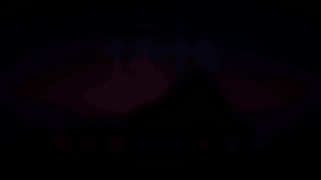
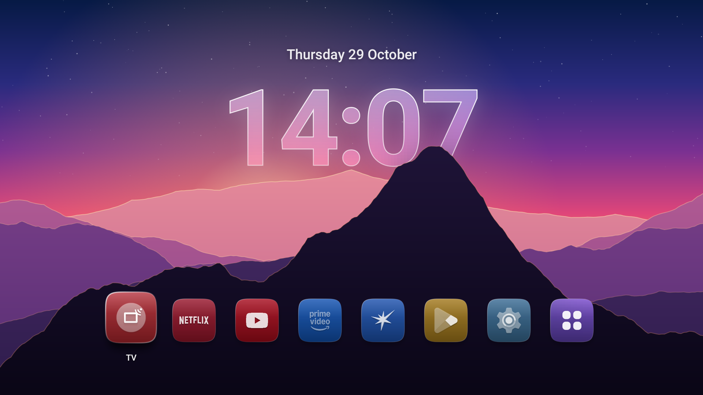
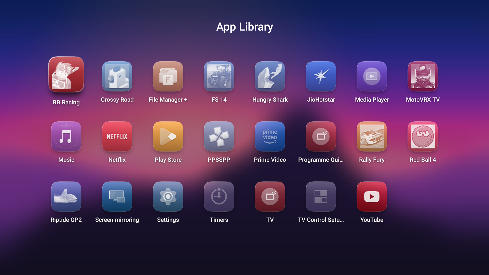

<div align="center">

# Glass

**A minimal, Liquid Glass–inspired home screen for Android TV.**

A sunset mountain wallpaper, a frosted-glass clock tucked behind the nearest peak,
one row of your favourite apps — and nothing else.



[▶ Watch the full-quality demo (MP4)](docs/demo.mp4)

</div>

---

## Why

Stock Android TV home screens are ad billboards: sponsored rows, "Shop" and "Discover"
tabs, trending carousels and auto-installed promos. I wanted my TV to feel like a lock
screen instead — calm, glanceable, and out of the way until I pick something to watch.

Glass is a from-scratch launcher (plain Java, no libraries, ~1,300 lines) built and
sideloaded onto a 2017 Sony BRAVIA (KD-43X8000E, Android TV 9).

## Features

| | |
|---|---|
|  |  |
| **Home** — glass clock with a depth effect and a single row of up to 7 favourites | **App Library** — every app A–Z on a frosted sheet |

- **Generated wallpaper** — layered dusk mountains with atmospheric haze, a setting sun,
  stars and light catching each ridge. The nearest ridge is a separate layer drawn *over*
  the clock, like the iOS lock-screen depth effect.
- **Glass clock** — the time is rendered as frosted glass: a slightly magnified, blurred
  copy of the wallpaper, a white gradient tint and a bright rim.
- **Tinted glass icons** — each app's own icon is turned into a white glyph and set on a
  glass squircle tinted with that app's brand colour (picked automatically from the icon).
- **Spring physics everywhere** — focus lift, menus, the library sheet and edge "bumps"
  are all driven by damped springs, so movement has a little overshoot.
- **Remote-first controls**
  - D-pad to move, **OK** to open
  - **Hold OK** (or press Menu) for the glass context menu: *Open, Move, Add to / Remove
    from Home, App Info, Hide App, Show Hidden Apps*
  - **Move** makes the icon jiggle; left/right repositions it and OK drops it
  - **Back** closes menus and the library
- **Remembers your layout**, picks up newly installed apps automatically, and never
  shows ads, recommendations or sponsored content.

## How it works

Everything is drawn by one custom `View` on a hardware-accelerated canvas — there are no
XML layouts and no third-party dependencies.

| File | What it does |
|---|---|
| [`HomeView.java`](src/com/hamza/glass/HomeView.java) | Layout, drawing (glass, clock, row, library, menu) and D-pad navigation |
| [`Gfx.java`](src/com/hamza/glass/Gfx.java) | Squircle path, mountain wallpaper (midpoint displacement), frosted blur, shadows |
| [`Apps.java`](src/com/hamza/glass/Apps.java) | Finds launchable apps, builds glyphs and brand colours, saves the layout |
| [`Spring.java`](src/com/hamza/glass/Spring.java) | The damped spring behind every animation |
| [`HomeActivity.java`](src/com/hamza/glass/HomeActivity.java) | The `HOME` activity; forwards keys and listens for app installs |

**Glass on Android 9.** Real-time blur (`RenderEffect`) only arrived in Android 12, so the
"glass" is faked: the wallpaper is static, so a heavily blurred, saturation-boosted copy
is rendered once and every glass shape samples it through a screen-aligned `BitmapShader`.
A white tint, a top sheen and a diagonal rim gradient finish the effect.

**Icons.** Adaptive icons use their foreground layer as the glyph. Other icons are split
from their dominant background colour; photo-style icons fall back to a soft luminance
"ghost". The tint is the most prominent saturated hue in the original icon.

## Install

You need a PC with `adb` and an Android TV on the same network with
**Developer options → Network debugging** turned on.

```bash
adb connect <tv-ip>:5555
adb install -r GlassLauncher.apk
adb shell cmd package set-home-activity com.hamza.glass/.HomeActivity
```

Press **Home** on the remote. To go back to the stock launcher:

```bash
adb shell cmd package set-home-activity com.google.android.tvlauncher/.MainActivity
```

## Build

No Gradle — [`build.ps1`](build.ps1) calls the Android SDK tools directly
(`aapt2 → javac → d8 → zipalign → apksigner`) and produces `build/GlassLauncher.apk`
in a few seconds.

Requirements: JDK 17, Android SDK with `build-tools;35.0.0` and `platforms;android-35`.
Adjust the paths at the top of `build.ps1` if yours differ.

```powershell
./build.ps1
```

A local signing key (`glass.keystore`) is generated on the first build and is not
committed.

## TV clean-up scripts

[`tv-tools/`](tv-tools) holds the scripts I used to de-clutter the TV before swapping the
launcher:

- [`debloat-tv.ps1`](tv-tools/debloat-tv.ps1) disables 26 preinstalled packages: ad
  tracking (Samba TV), the promo auto-installer, store demo/hotel modes, help and logging
  apps, the old Vewd store and unused Google apps
- [`restore-tv.ps1`](tv-tools/restore-tv.ps1) re-enables all of them and restores the
  stock home screen

Packages are **disabled, not uninstalled**. A factory reset also brings everything back.
The list is specific to Sony BRAVIA firmware, so review
[`disabled-packages.txt`](tv-tools/disabled-packages.txt) before running it on another TV.

## Notes

- Tested on one TV: Sony BRAVIA KD-43X8000E, Android 9, 1920×1080 UI.
- The visual style is inspired by Apple's iOS 26 design language, but the project is
  not affiliated with or endorsed by Apple. It uses no Apple assets, fonts or icons —
  app icons come from the apps installed on your TV.

## License

[MIT](LICENSE) © 2026 Hamza
